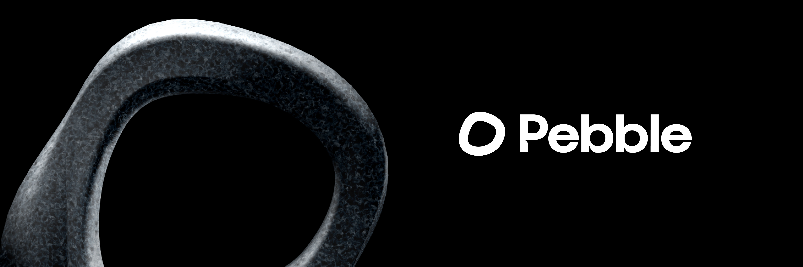

<p align="center">
  
  <p align="center">A simple, yet rock solid, functional language with an imperative bias, targeting UPLC</p>

  <p align="center">
    <a href="https://twitter.com/hlabs_tech">
      
    </a>
    <a href="https://twitter.com/MicheleHarmonic">
      
    </a>
  </p>
</p>

# Pebble LSP

A VS Code Language Server Protocol (LSP) extension for the Pebble programming language, providing comprehensive language support including syntax highlighting, diagnostics, and intelligent code features.

## Features

### ✅ Implemented Features

#### Language Support

- **Syntax Highlighting**: Complete TextMate grammar for Pebble language syntax
- **Language Configuration**: Proper bracket matching, auto-closing pairs, and comment support
- **File Association**: Automatic detection of `.pebble` files

#### LSP Features

The features below are answered by the compiler's own index of the checked program
(`@harmoniclabs/pebble@0.6.0`: `Compiler.check()` returns diagnostics, a type map and a
symbol index of every file it compiled — the entry and everything it imports). Where the
index has nothing to say (no check yet, a file that does not parse), the syntax tree is
used instead.

- **Diagnostics**: real-time errors and warnings from `Compiler.check()`
  - Type errors, name-resolution errors and parse errors, with their ranges
  - `check()` goes past errors: a file with a parse error is still type-checked, so one
    mistake does not silence the rest of the file
  - The check runs with the project root (the directory of `pebble.config.json`), so
    imports resolve the way they do for `pebble build`

- **Go to Definition**: on any name, through scopes and imports
  - Parameters, constants, variables, functions, structs, fields, constructors, methods,
    enums, type aliases, contracts and their methods
  - An imported name jumps to its declaration in the other file

- **Find All References**: every use of a name, across the files of the project
  - An import and its uses are references of the declaration; an alias
    (`import { a as b }`) is a name of its own
  - The project's check (its `pebble.config.json` `entry`) is consulted as well, so
    references reach files that import this one

- **Hover**: the kind and type of the symbol under the cursor
  - `function double: (int) => int`, `constant K: int`, `parameter p: Point`,
    `field x: int` — with a note where an import leads (`// imported from src/lib.pebble`)
  - Contract `context` and its destructured fields

- **Code Completion**: the names visible at the cursor (`SymbolIndex.visibleAt`),
  innermost first — locals, parameters, imports and top-level declarations, with their
  types as detail — plus keywords, built-in types, and the members of a type after a `.`

- **Document Highlighting**: highlights related code elements when cursor is positioned on:
  - Function declarations and their body statements
  - Control flow statements (if, for, while, etc.)
  - Assert and fail statements
  - All statement types within function bodies

- **Rename**, **Document Symbols**, **Signature Help**, **Semantic Tokens**: as before
  (rename still matches names by text in the syntax tree)

### 📋 Supported Statement Types

The LSP recognizes and provides features for all Pebble statement types:
- Import/Export statements (`import`, `export`, `export *`)
- Variable declarations (`var`)
- Control flow (`if`, `for`, `for-of`, `while`, `return`, `break`, `continue`)
- Function and struct declarations
- Block statements
- Test and assertion statements (`test`, `assert`, `fail`)
- Match statements
- Expression statements
- Using statements
- Type implementation statements

### ⚙️ Language Configuration

- **Comments**: Line comments (`//`) and block comments (`/* */`)
- **Brackets**: Auto-matching for `{}`, `[]`, `()`, and `${}`
- **Auto-closing Pairs**: Automatic closing of brackets, quotes, and template literals
- **Auto-surrounding Pairs**: Smart surrounding of selected text
- **Folding**: Code folding support for blocks and comments

## Running the extension

1. Run the command: `npm install`
2. Go to "Run and Debug" in VS Code and press "play" on the job "Launch Extension"
3. A new window will open and you should open the folder with the examples and select on .pebble file from there

## Architecture

The extension consists of two main components:

### Client (`client/src/extension.ts`)
- VS Code extension entry point
- Manages the Language Server Protocol client
- Handles activation/deactivation lifecycle
- Configures document selectors for `.pebble` files

### Server (`server/src/server.ts`)
- LSP server implementation using `@harmoniclabs/pebble` compiler
- Provides real-time diagnostics through AST compilation
- Implements hover, highlighting, and completion features
- Handles all LSP protocol communications

## Development

### Running the extension

1. Run the command: `npm install`
2. Go to "Run and Debug" in VS Code and press "play" on the job "Launch Extension"
3. A new window will open and you should open the folder with the examples and select on .pebble file from there

### Testing the server without VS Code

`npm test` compiles the extension and runs a headless LSP client
(`server/test/lsp.test.mjs`) that spawns `node server/out/server.js --stdio` and drives it
the way an editor does, against the fixtures in `server/test/fixtures/project`:

```sh
npm test                          # from the repository root
cd server && npm test             # against the already compiled `out/`
```

It checks the diagnostics pushed on `didOpen` (a clean file, a deliberate type error and
its range, a file that does not parse), hover, go to definition (including a symbol
imported from another file), find references across files, completion of visible names and
of a type's members after a `.`, and that 0.6.0 syntax (map literals, `case … is Some{} =>`,
`+=`) type-checks clean. It exits non-zero on the first failed check.

### Known limitations

- **`tree-sitter-pebble@0.3.0` lags the language.** The syntax tree still fails on some
  current syntax — map literals (`{ #01: 10 }`), `case … is Some{} =>`, and struct literals
  in return position (`return Point{ … }`) — so the tree-sitter fallbacks (document
  highlight, signature help, rename, semantic tokens, and any answer the compiler index
  does not give) can be wrong or empty there. `+=` parses fine. Diagnostics, definition,
  references, hover and completion do not depend on the tree: they come from the compiler.
- **References are as wide as the project's check.** `references()` answers for the files
  a check compiled. The server unions the open document's check with the project's own
  (`pebble.config.json` `entry`), so files outside that graph (a test file the entry does
  not import, say) are not searched. Rename still matches by name in the syntax tree.
- **One check per keystroke.** Every change re-runs `Compiler.check()` on the document and
  re-checks the open documents that import it. There is no debounce.